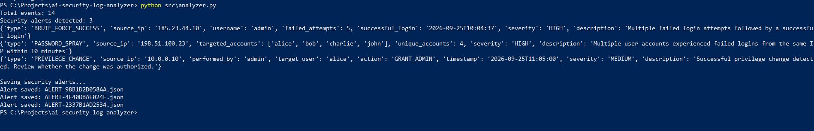
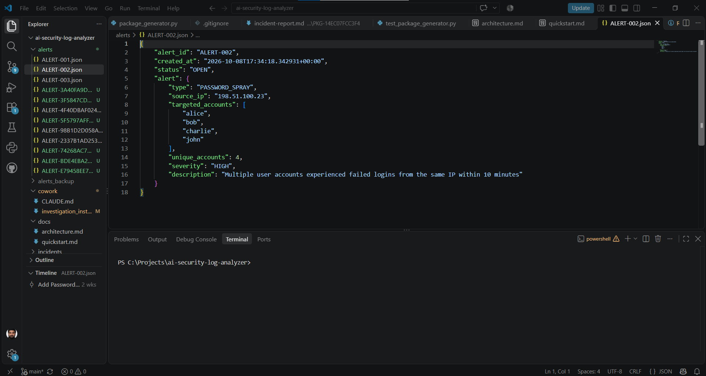
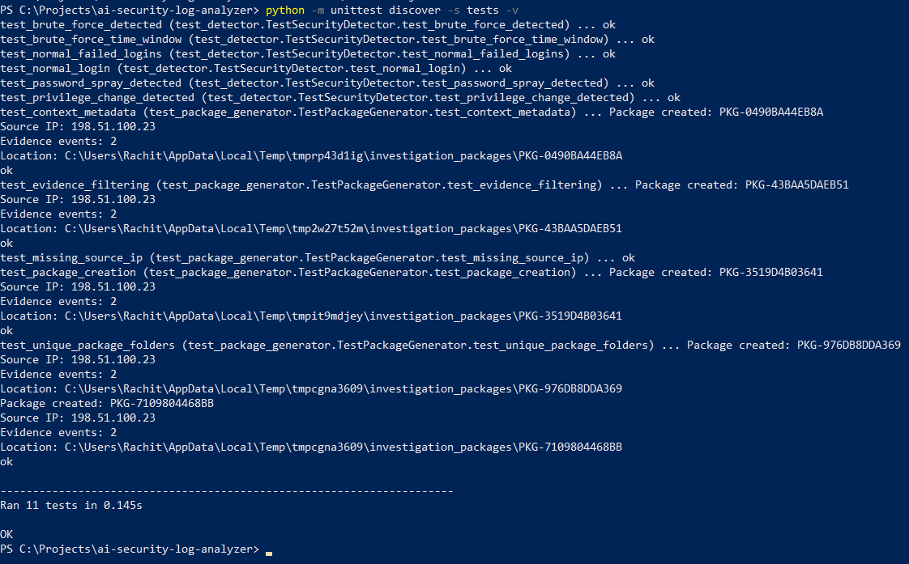
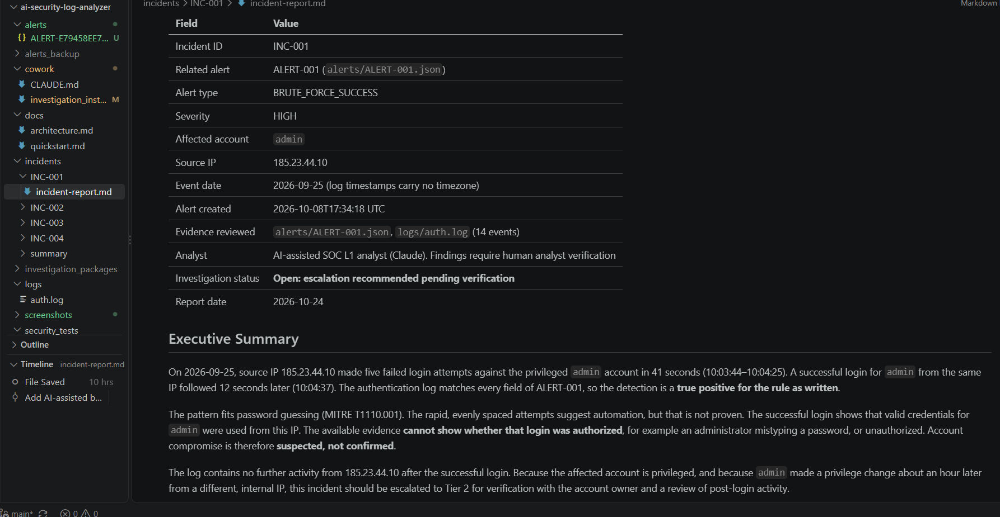

# ai-security-log-analyzer
Python-based security log analyzer with AI-assisted SOC investigation using Claude Cowork.

## Project Highlights

- Python-based security log parsing and threat detection
- Three custom security detection rules
- Persistent JSON alert generation with unique IDs
- Automated investigation package creation
- AI-assisted incident analysis using Claude Cowork
- MITRE ATT&CK technique mapping
- Prompt-injection security evaluation
- 11 automated Python unit tests

## Project Demonstration

### Security Detection Engine

### Structured JSON Security Alert

### Automated Security Testing

### AI-Assisted Incident Investigation

## Technical Documentation

- [System Architecture](docs/architecture.md)
- [Quick Start Guide](docs/quickstart.md)
- [Incident Investigations](incidents/README.md)
- [Consolidated Investigation](incidents/summary/security-investigation-summary.md)
- [Prompt Injection Evaluation](security_tests/prompt_injection_results.md)

# AI-Powered Security Log Analyzer

A Python-based cybersecurity automation project that parses
authentication logs, identifies suspicious activity, generates
structured JSON security alerts, and supports AI-assisted
incident investigations using Claude Cowork.

## Project Overview

This project demonstrates a simplified Security Operations
Center (SOC) workflow, combining Python log analysis,
rule-based threat detection, automated testing, and
AI-assisted security investigations.

The goal is to reduce manual log review and produce
consistent security alerts for further investigation.

## Features

- Parse authentication logs into structured Python dictionaries.
- Detect brute-force attempts followed by successful logins.
- Identify potential password-spraying activity.
- Monitor successful account privilege changes.
- Generate JSON security alerts with severity and timestamps.
- Validate detection rules through automated unit tests.
- Prepare structured alerts for AI-assisted investigation.

## Technologies Used

- Python 3
- Python unittest
- JSON
- Git and GitHub
- Claude Cowork (planned AI investigation integration)
- MITRE ATT&CK (planned investigation mapping)

## Technologies and Skills

| Category | Technologies |
|---|---|
| Programming | Python 3 |
| Data Processing | JSON, pathlib, datetime, collections |
| Security Detection | Custom Python detection rules |
| Automation | Python scripting, structured alert generation |
| Security Analysis | Authentication logs, event correlation |
| AI Investigation | Claude Cowork |
| Threat Framework | MITRE ATT&CK |
| AI Security | Indirect prompt-injection testing |
| Testing | Python unittest, unittest.mock |
| Version Control | Git, GitHub |
| Documentation | Markdown, Mermaid |

## Validation

- 6 automated detection tests
- 5 investigation package tests
- 11 total passing tests
- Manual review of AI-assisted investigation reports
- Controlled prompt-injection evaluation

## Detection Rules

### 1. Brute-Force Success

Detects five or more failed login attempts followed by
a successful login for the same user and source IP
within a 10-minute window.

Severity: HIGH

### 2. Password Spraying

Detects failed authentication attempts against at least
three unique accounts from the same source IP within
a 10-minute window.

Severity: HIGH

### 3. Privilege Change

Flags successful privilege-change events for
security review.

Severity: MEDIUM

## Project Structure

    ai-security-log-analyzer/
    ├── logs/
    │   └── auth.log
    ├── src/
    │   ├── analyzer.py
    │   ├── detector.py
    │   └── incident_creator.py
    ├── tests/
    │   └── test_detector.py
    ├── alerts/
    │   ├── ALERT-001.json
    │   ├── ALERT-002.json
    │   └── ALERT-003.json
    ├── cowork/
    ├── incidents/
    ├── screenshots/
    └── README.md

## How to Run

Requirements:
- Python 3 installed
- Git installed

Clone the repository:

    git clone https://github.com/rachitsingla99/ai-security-log-analyzer.git

Navigate into the project:

    cd ai-security-log-analyzer

Run the analyzer:

    python src/analyzer.py

Run automated tests:

    python -m unittest discover -s tests -v

## Example Detection

Input authentication logs:

    LOGIN FAILED - admin - 185.23.44.10
    LOGIN FAILED - admin - 185.23.44.10
    LOGIN FAILED - admin - 185.23.44.10
    LOGIN FAILED - admin - 185.23.44.10
    LOGIN FAILED - admin - 185.23.44.10
    LOGIN SUCCESS - admin - 185.23.44.10

Expected output:

    Alert Type: BRUTE_FORCE_SUCCESS
    Source IP: 185.23.44.10
    Username: admin
    Failed Attempts: 5
    Severity: HIGH

The application also saves the alert as a JSON file.

## Automated Testing

Six unit tests currently validate detection behavior,
including attack scenarios and normal login activity.

All six tests passed during local development.

## AI-Assisted Incident Investigation

Planned Claude Cowork capabilities include:

- Summarizing security alerts
- Building incident timelines
- Extracting indicators of compromise
- Mapping relevant MITRE ATT&CK techniques
- Recommending investigation and containment steps
- Drafting incident reports
- Testing resistance to prompt injection in log data

AI-generated findings will require analyst verification.

## Limitations

This is an educational prototype, not a production SIEM.

- Detection rules use simplified heuristics.
- No real-time log collection is implemented.
- Alert filenames are reused on subsequent executions.
- Authentication logs are synthetic.
- Additional validation and false-positive testing are needed.
- AI integration is not yet implemented.

This is an educational SOC automation prototype.

It does not currently include real-time monitoring,
alert deduplication, production SIEM integrations,
or fully automated Claude Cowork execution.

AI-assisted investigations require human initiation
and verification.

## Security Considerations

Use synthetic or properly sanitized logs.
Do not upload credentials, secrets, personal information,
or confidential organizational logs to AI tools.

Treat all log content as untrusted data.

## Future Improvements

- Persistent alert storage
- More attack-detection rules
- Real-time log monitoring
- Security dashboards
- MITRE ATT&CK mapping
- Automated AI investigation reports
- Enhanced input validation and error handling

## Author

Rachit Singla

Cybersecurity | Security Automation | Python

