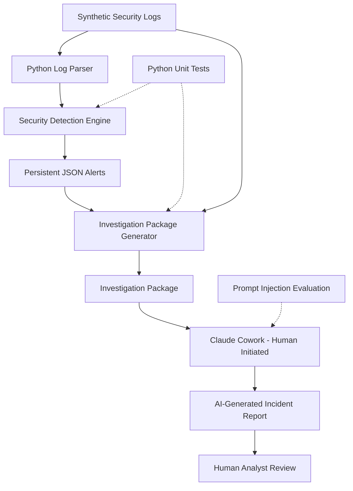

# System Architecture

## AI-Powered Security Log Analyzer

### 1. Project Objective

Build a Python-based cybersecurity automation system
that detects suspicious authentication activity,
generates structured security alerts, and supports
AI-assisted incident investigations using Claude Cowork.

This project demonstrates a simplified SOC workflow
using synthetic security events.

## 2. Architecture Diagram



## 3. System Components

### A. Log Parser

File: src/analyzer.py

Responsibilities:
- Read authentication log files.
- Parse raw log entries.
- Convert events into structured Python dictionaries.
- Pass structured events to the detection engine.

### B. Detection Engine

File: src/detector.py

Detection rules:

1. Brute-force success:
   Five or more failed login attempts followed by
   a successful login for the same IP and username
   within a 10-minute window.

2. Password spraying:
   Failed login attempts against three or more
   unique accounts from one IP within 10 minutes.

3. Privilege changes:
   Successful privilege-change events are flagged
   for security review.

### C. JSON Alert Generator

File: src/incident_creator.py

Responsibilities:
- Generate unique alert identifiers.
- Store alert metadata.
- Save structured JSON security alerts.
- Prevent accidental overwriting of existing files.

### D. Investigation Package Generator

File: src/package_generator.py

Responsibilities:
- Read a selected security alert.
- Identify its source IP.
- Collect matching raw log events.
- Create structured investigation metadata.
- Generate standardized investigation instructions.
- Preserve original alert evidence in a package.

### E. Claude Cowork Investigation

Claude Cowork receives a prepared investigation
package through a user-initiated task.

It assists with:
- Alert validation
- Incident timeline reconstruction
- Security event interpretation
- MITRE ATT&CK technique mapping
- Recommended response actions
- Markdown incident report generation

AI findings require human verification.

### F. Human Analyst Review

The analyst validates generated reports against
the original evidence.

Review status is recorded separately from
incident resolution status.

## 4. Data Flow

1. Python reads logs/auth.log.
2. Events are parsed into dictionaries.
3. Detection rules identify suspicious patterns.
4. Security alerts are saved as JSON files.
5. An analyst selects an alert for investigation.
6. Python generates an investigation package.
7. The analyst opens the package in Claude Cowork.
8. Claude produces a Markdown investigation report.
9. The analyst verifies and reviews the report.

## 5. Security Controls

- Synthetic log data only.
- No production system access.
- Untrusted log content is treated as evidence.
- Prompt-injection testing is included.
- AI-generated findings require human review.
- Original alerts and logs are preserved.
- Investigation actions do not perform containment.

## 6. Automated Testing

The project includes 11 Python unit tests:

- 6 detection-engine tests
- 5 investigation-package tests

These tests verify selected expected behaviors,
not complete production security or reliability.

## 7. Known Limitations

- Log processing is batch-based, not real-time.
- Reprocessing the same data can create duplicate alerts.
- Evidence correlation uses source IP only.
- No centralized SIEM integration is implemented.
- Claude Cowork investigations require manual initiation.
- No production authentication or MFA data is available.
- Input validation is limited.
- AI output quality requires human verification.
- The project uses synthetic rather than real attack data.

## 8. Future Enhancements

- Alert deduplication using event fingerprints.
- Time-window-based evidence correlation.
- Additional automated security tests.
- Real-time log ingestion.
- Integration with security monitoring platforms.
- Automated incident queue management.
- SIEM and ticketing-system integrations.
- More comprehensive prompt-injection evaluations.
```
